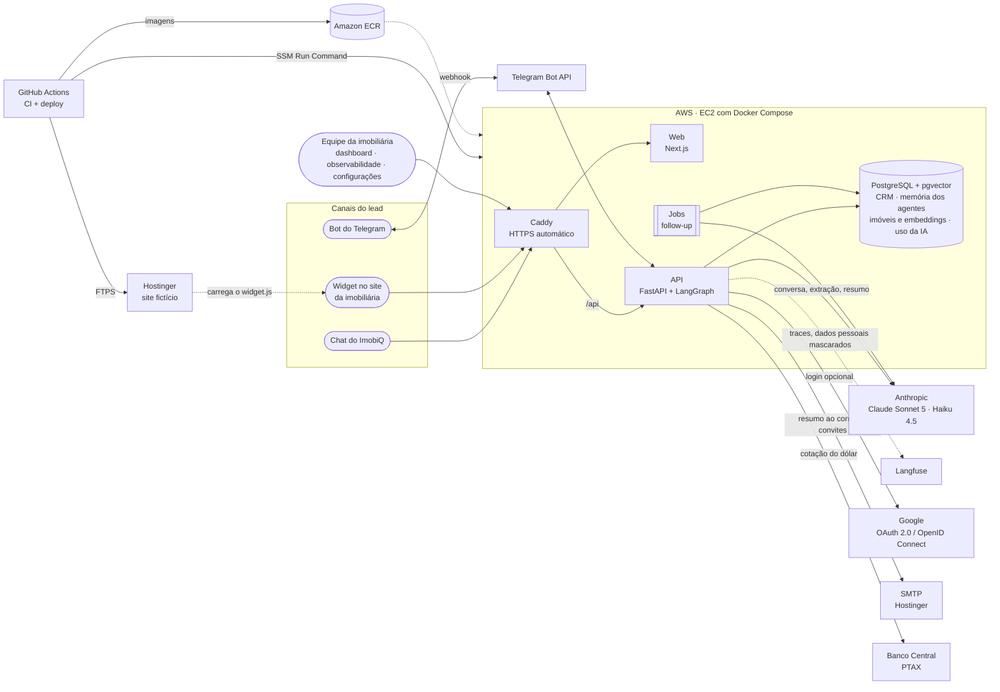

# 🏠 ImobiQ — Agente SDR Imobiliário com IA Generativa


-D97757)


POC do **Hackathon FIAP — Pós Tech IA para Devs (Fase 5)** · Turma 8IADT · Grupo 65 (Rodrigo Rosa, Elias Silva, Fabia Jesus e Danilo Pereira): um agente SDR para **imóveis comerciais** que atende empresas e investidores, conversa de forma humanizada, faz a qualificação B2B (atividade, espaço, orçamento, quem decide e prazo), sugere conjuntos, andares corporativos, lajes, prédios e galpões logísticos de uma base simulada (inspirada na carteira de uma imobiliária de real estate corporativo de São Paulo), agenda visitas com o corretor especialista, faz follow-up automático e envia resumos aos corretores. A base também tem alguns residenciais de alto padrão, e a Laris atende os dois segmentos.

| 🌐 Demonstração | Endereço |
|---|---|
| 🖥️ ImobiQ (chat, dashboard, observabilidade) | https://imobiq.arrtsoftware.com.br |
| 🏠 Site fictício de imobiliária, com a Laris embutida | https://imobiliaria-exemplo.arrtsoftware.com.br |

> 🔑 O chat e o site fictício são públicos. O dashboard, a observabilidade e as configurações pedem login, e o acesso é por convite. A instância da AWS fica ligada só durante os testes e a demonstração.

> 🚧 Documentação completa (arquitetura, explicação da IA, demo e pitch) será finalizada ao longo do desenvolvimento.

---

## 🧱 Stack

| Camada | Tecnologia |
|---|---|
| 🧠 LLMs | Claude Sonnet 5 (conversa) · Claude Haiku 4.5 (roteamento, extração, resumo, follow-up) |
| 🕸️ Orquestração | LangGraph (supervisor + agentes especialistas, memória com checkpointer Postgres) |
| ⚙️ Backend | Python 3.12 · FastAPI · SQLAlchemy · Alembic |
| 🗄️ Dados | PostgreSQL 16 + pgvector |
| 🔎 RAG | Busca híbrida: embeddings locais (fastembed, MiniLM multilíngue) + full-text search em português, fundidos por RRF |
| 🖥️ Frontend | Next.js 16 · React 19 · TypeScript · Tailwind CSS 4 · lucide-react |
| 📈 Observabilidade | Painel próprio (uso e custo de cada chamada ao Claude gravados no Postgres) · Langfuse para os traces |
| 🔐 Acesso | E-mail e senha (hash scrypt) ou Google (OAuth 2.0 / OpenID Connect) · papéis · sessão em cookie `HttpOnly` |
| ☁️ Infra | Docker Compose · AWS (EC2, ECR, SSM) · Caddy (HTTPS) · GitHub Actions |

## 🏗️ Arquitetura da solução



O lead conversa pelo chat do ImobiQ, pelo widget embutido no site da imobiliária ou pelo Telegram; os três canais caem na mesma API, no mesmo grafo de agentes e na mesma memória. A equipe da imobiliária usa o mesmo app, com login. Tudo o que é estado (CRM, conversas, memória dos agentes, base de imóveis com embeddings, registro de uso da IA, usuários) fica num único PostgreSQL.

### 🔁 Componentes externos e alternativas

Cada serviço externo fica atrás de um módulo próprio da API, então pode ser trocado sem mexer nos agentes. A tabela mostra o que a POC usa e duas alternativas que se encaixam no mesmo ponto (não implementadas).

| Papel na solução | Usado na POC | Alternativas | O que muda na troca |
|---|---|---|---|
| 💬 Canal de mensageria | **Telegram** (Bot API, gratuito, sem aprovação) | WhatsApp Business (Cloud API da Meta) · Instagram Direct / Messenger | Um novo adaptador de canal como o `services/telegram.py` (receber o webhook, enviar a resposta); o lead já tem o campo de canal. O WhatsApp exige conta comercial verificada e modelos de mensagem aprovados para o follow-up. |
| 🧠 Modelos de linguagem | **Claude** (API da Anthropic) | Claude no Amazon Bedrock · Claude no Google Vertex AI | Só o cliente em `agents/llm.py`; útil para faturar pela nuvem que a empresa já usa. |
| 📈 Observabilidade de IA | **Langfuse** (traces) + painel próprio no Postgres | LangSmith · Arize Phoenix (código aberto, pode rodar na própria infraestrutura) | O módulo `core/observability.py`; o painel de custo do ImobiQ não depende da ferramenta escolhida. |
| 🔐 Login | **E-mail e senha** + **Google** | Microsoft Entra ID (contas corporativas Microsoft 365) · Keycloak ou Auth0 (provedor de identidade central) | Um novo fluxo OpenID Connect como o `services/google_oauth.py`; usuários, papéis e sessão continuam os mesmos. |
| ✉️ E-mail | **SMTP da Hostinger** | Amazon SES · SendGrid | Só as variáveis `SMTP_*` do `.env`: o envio é SMTP padrão. |
| 🔎 Busca vetorial (RAG) | **pgvector** no próprio Postgres | Qdrant · Amazon OpenSearch | A função de busca em `services/property_search.py`; vale a pena só com uma base muito maior que a de uma imobiliária. |
| ☁️ Hospedagem | **EC2** com Docker Compose | AWS ECS Fargate + RDS · AWS App Runner + RDS | Os mesmos contêineres; a API não guarda estado, então escala horizontalmente. |

## 🤖 Como o agente funciona


- **Supervisor (Haiku):** a cada mensagem, lê a conversa e devolve o perfil do lead em saída estruturada: segmento, empresa, cargo, se é o decisor, atividade, área ou nº de pessoas, requisitos, orçamento, região, urgência e perfil de investidor (no residencial, quartos). Regras determinísticas calculam campos faltantes (no comercial, seguindo o BANT: necessidade, orçamento, autoridade e prazo), score (0-100), temperatura e etapa do funil, e escolhem o agente que responde. O perfil registra só o que o cliente disse: a finalidade (compra, aluguel ou investimento) exige um trecho citado literalmente da mensagem do cliente, conferido pelo código, e a busca de imóveis fica travada até ela ser declarada. O telefone é obrigatório para confirmar uma visita: a ferramenta `agendar` recusa o horário enquanto ele não foi informado, e a Laris pede de novo. A visita só é agendada sem telefone se o cliente se recusar a informar (no Telegram, um botão envia o número com um toque).
- **Agentes (Sonnet):** persona humanizada ("Laris"), uma pergunta por vez, guiada pela lista de campos faltantes. *Locação e Compra* e *Investimentos* (imóveis locados, cap rate) qualificam e sugerem imóveis; *Agendamento* consulta a agenda do corretor especialista no tipo de imóvel (sedes corporativas, conjuntos, galpões, residenciais de alto padrão, ou o especialista em investimentos) e confirma visitas e reuniões. A busca entende a linguagem do cliente ("escritório", "sede", "andar", "CD", "Faria Lima", "JK", "Berrini", "Via Dutra") e filtra por atividade permitida, área, vagas, docas e pé-direito. Nos aluguéis, a Laris informa o custo mensal total (aluguel + condomínio + IPTU).
- **Resumo inteligente:** ao agendar ou encaminhar, o corretor recebe um briefing estruturado (perfil, necessidades, imóveis de interesse, objeções, próximos passos, abordagem sugerida) **por e-mail**, com o convite de calendário (.ics) da visita anexado. No modo demonstração, todos os e-mails vão para uma única caixa, com o corretor de destino no assunto.
- **Follow-up automático:** um job reserva leads sem resposta (`FOR UPDATE SKIP LOCKED`, seguro com várias instâncias) e envia mensagens com o contexto da conversa. Cada tentativa usa uma estratégia (retomar, agregar valor, encerrar), com cadência crescente; depois da última, o lead vai para *perdido*. Se ele voltar, a conversa continua de onde parou. O envio pode ser pausado, ter a cadência ajustada ou um horário de silêncio definido em tempo real na tela de configurações.
- **Memória:** o histórico completo (inclusive ferramentas e follow-ups) é o estado do grafo LangGraph, persistido no Postgres pelo checkpointer. A conversa continua mesmo após reiniciar a API.
- **Observabilidade:** com as chaves do Langfuse no `.env`, cada turno vira um trace agrupado por conversa, com os nós do grafo, cada chamada ao Claude (tokens, cache, latência) e cada ferramenta. A tela **Observabilidade** do ImobiQ não depende do Langfuse nem da cota da API dele: o app grava no próprio Postgres cada chamada ao Claude (agente, modelo, tokens por tipo, latência e custo pela tabela de preços da Anthropic), cada ferramenta e cada turno, e o painel lê de lá, convertendo para reais pela cotação do dia (PTAX do Banco Central): custo com IA, custo por conversa, **custo por visita agendada**, economia com prompt caching, tempo de resposta, custo por agente e por modelo, ferramentas usadas e tentativas de prompt injection. O detalhe fica no Langfuse: o menu e cada lead têm link direto para o projeto e para a sessão da conversa. Os testes gravam no banco de testes e no ambiente `test` do Langfuse, fora do painel.

### 💬 API

| Método | Rota | Descrição |
|---|---|---|
| `POST` | `/chat/sessions` | Inicia uma conversa (cria o lead) |
| `POST` | `/chat/{lead_id}/messages` | Envia mensagem; resposta via **SSE** (`analysis`, `agent`, `token`, `tool`, `properties`, `appointment`, `handoff`, `done`) |
| `GET` | `/chat/{lead_id}/messages` | Histórico da conversa (inclui follow-ups) |
| `GET` | `/leads` 🔒 | Leads com score, temperatura e etapa do funil (filtros: `status`, `temperature`, `intent`) |
| `GET` | `/leads/{lead_id}` 🔒 | Detalhe do lead: perfil, resumo, agendamentos e conversa |
| `POST` | `/leads/{lead_id}/summary` 🔒 | Gera ou atualiza o resumo para o corretor |
| `POST` | `/leads/{lead_id}/summary/email` 🔒 | Envia o resumo ao corretor por e-mail agora |
| `GET` | `/appointments` 🔒 | Próximos agendamentos |
| `GET` | `/dashboard/metrics` 🔒 | KPIs: funil, temperatura, intenção, agendamentos e follow-ups |
| `GET` | `/observability` 🔒 | Painel de custo, uso dos agentes, cache e latência (`period`: `24h`, `7d` ou `30d`) |
| `GET` | `/auth/me` | Sessão atual: formas de login disponíveis e o usuário logado, com o papel |
| `POST` | `/auth/login` | Abre a sessão (cookie `HttpOnly`, 12 horas) com e-mail e senha, ou só com a senha de administrador (emergência) |
| `GET` | `/auth/google/login` | Leva ao login do Google; a volta é em `/auth/google/callback` |
| `POST` | `/auth/forgot` | "Esqueci minha senha": envia por e-mail um link de uso único |
| `GET` / `POST` | `/auth/password` | Confere o link recebido e define a senha (exige o aceite dos termos na criação da conta) |
| `POST` | `/auth/logout` | Encerra a sessão |
| `GET` / `POST` | `/users` 👑 | Lista os usuários e convida um e-mail com um papel |
| `PATCH` / `DELETE` | `/users/{id}` 👑 | Troca o papel, vincula a um corretor, desativa ou exclui |
| `POST` | `/users/{id}/access-link` 👑 | Gera (e envia) um novo link para criar ou redefinir a senha |
| `GET` / `PUT` | `/config/ai` 👑 | Liga/desliga o uso das LLMs |
| `GET` / `PUT` | `/config/followup` 👑 | Lê/altera o follow-up em tempo real (liga/desliga, minutos, tentativas, horário de silêncio) |
| `GET` / `PUT` | `/config/email` 👑 | Lê/altera o envio de e-mails (liga/desliga, modo demonstração, caixa de demonstração) |
| `POST` | `/config/email/test` 👑 | Envia um e-mail de teste para validar o SMTP |
| `GET` / `PUT` | `/config/rate-limit` · `/config/widget` · `/config/telegram` · `/config/exchange` 👑 | Limites de mensagens, domínios do widget, bot do Telegram e cotação do dólar do painel |
| `POST` | `/followups/run` 👑 | Dispara o ciclo de follow-up na hora, mesmo pausado (útil na demo) |
| `POST` | `/admin/demo/reset` 👑 | Apaga leads/conversas/agenda e recria os dados de demonstração |

🔒 exige login (o corretor recebe só os próprios leads e visitas; o visualizador não altera nada) · 👑 só administradores. Sem `ADMIN_PASSWORD` e sem credenciais do Google (ambiente local), tudo fica aberto.

## 🖥️ Telas

| Tela | O que mostra |
|---|---|
| 🏠 **Página inicial** (`/`) | Apresentação da Laris, atalhos para o chat e o dashboard, link para o site fictício da imobiliária e o botão **Login**. |
| 💬 **Chat do lead** (`/chat`) | Conversa no estilo WhatsApp com a Laris: resposta em streaming, indicador do que a IA está fazendo ("consultando imóveis…"), cards dos imóveis sugeridos, confirmação de agendamento e follow-ups que chegam sozinhos. Ao lado, o painel **"O que a IA está entendendo"** mostra em tempo real o agente ativo, score, temperatura, perfil extraído e as próximas perguntas da qualificação. |
| 📊 **Dashboard do corretor** (`/dashboard`) | Indicadores (leads, taxa de qualificação, quentes, agendamentos, follow-ups), funil por etapa, intenção dos leads, **canal de entrada** (chat ImobiQ, só site, só Telegram ou site → Telegram), próximos agendamentos e tabela de leads com filtros e o canal de cada lead. Atualiza sozinho a cada 10s. Exige login; o corretor vê só os leads e as visitas dele, com os indicadores no mesmo recorte. |
| 🗂️ **Detalhe do lead** (`/dashboard/leads/{id}`) | Resumo inteligente para o corretor (gerar/atualizar), status e histórico do e-mail ao corretor (com reenvio), perfil, agendamentos e a conversa completa (com a divisória "continuou no Telegram" no ponto em que o lead trocou de canal), com o agente que respondeu cada mensagem e os follow-ups marcados. O visualizador não tem os botões de gerar resumo e de enviar e-mail. |
| 🧩 **Chat no widget** (`/embed`) | Versão enxuta do chat usada dentro do iframe do widget, com a marca da imobiliária, saudação sobre o imóvel da página e botão de fechar. |
| 📈 **Observabilidade** (`/observability`) | Para administradores, gestores e visualizadores. Visão sintética de 24h, 7 ou 30 dias: custo com IA (US$ e R$), custo por conversa e por visita agendada, economia com cache, tempo de resposta (mediana e p95), custo por dia, por modelo e por agente, ferramentas usadas e tentativas de prompt injection, com link para o Langfuse. |
| ⚙️ **Configurações** (`/configuration`) | Só para administradores. **Usuários e papéis**: convida por e-mail, troca o papel, vincula o corretor, gera o link de senha, desativa e exclui. **Liga/desliga do atendimento com IA**: pausado, nada chama o Claude (o chat, o widget e o Telegram respondem um recado fixo pedindo nome e telefone e guardam a mensagem; follow-ups e resumos param), para o site público não gastar tokens fora das demonstrações. Liga/desliga do follow-up com efeito imediato, minutos até a 1ª tentativa, máximo de tentativas, horário de silêncio e botão "rodar agora". Controla o e-mail aos corretores (liga/desliga, modo demonstração, e-mail de teste) e a cotação do dólar do painel de observabilidade (busca diária no Banco Central ligada/desligada e cotação fixa de reserva). Também reseta os dados de demonstração (8 leads em todas as etapas do funil, com conversas, resumos e agendamentos). |
| 🔐 **Login e criação de senha** (no próprio `/dashboard` e em `/password`) | E-mail e senha com "esqueci minha senha", botão **Entrar com Google** e o acesso de emergência do administrador. O convidado cria a senha pelo link recebido, marcando o aceite dos termos. |
| 📜 **Política de Privacidade e Termos de Uso** (`/privacidade` e `/termos`) | Páginas públicas, ligadas no rodapé de todas as telas: quais dados são tratados, com quem são compartilhados e as regras de uso da POC. |

A conversa fica salva no navegador (o lead é retomado ao recarregar); use **Nova conversa** para simular outro lead. Os atalhos iniciais do chat reproduzem os três cenários do enunciado.

## 🧩 Widget para sites de imobiliárias

A Laris pode ser instalada no site de qualquer imobiliária com uma linha, antes de `</body>`:

```html
<script src="https://SEU-APP/widget.js" data-brand="Nome da Imobiliária" data-property="IMV-007" defer></script>
```

- Uma bolha flutuante abre o chat num iframe (tela cheia no celular). O chat só carrega no primeiro clique, sem pesar no site, e o CSS fica isolado (Shadow DOM).
- A Laris se apresenta em nome da imobiliária (`data-brand`) e, na página de um imóvel (`data-property`), já abre falando dele e responde sobre "este imóvel".
- O dashboard mostra a origem do lead: site, página de entrada e campanha (UTM de primeiro toque).
- A conversa continua se o visitante recarregar ou mudar de página (a sessão fica guardada no domínio do site).
- Opcionais: `data-teaser-delay` (segundos até o convite aparecer; `0` desliga) e `data-position="left"`. API JavaScript: `ImobiQ.open()`, `ImobiQ.open({ message })` (abre o chat com a mensagem já digitada, para o visitante revisar e enviar), `ImobiQ.close()`, `ImobiQ.toggle()`.

O site fictício da **Imobiliária Exemplo** (`site-exemplo/`) é gerado a partir da mesma base de imóveis e serve de demonstração, com o visual de uma imobiliária de real estate corporativo: busca por pretensão (alugar, comprar, investir) e por código, cards com o código do imóvel, página do imóvel com pacote de locação e especificações técnicas, e o formulário "Fale com a imobiliária" e o "Encomende seu imóvel" abrindo a Laris com a mensagem pronta. Para produção, gere apontando para o widget publicado e suba a pasta `dist/` em qualquer hospedagem estática:

```bash
python site-exemplo/build.py --widget https://SEU-APP/widget.js
```

No WordPress, a linha do script pode ser colocada com um plugin de inserção de código no rodapé (ex.: WPCode).

## ✈️ Bot do Telegram

A mesma Laris atende pelo Telegram ([@imobiq_laris_bot](https://t.me/imobiq_laris_bot)), com a mesma memória, qualificação, busca e agenda do chat web:

- Cada conversa com o bot vira um lead com canal **Telegram** no dashboard; `/nova` recomeça o atendimento.
- "digitando…" enquanto ela pensa, respostas formatadas, imóveis citados com resumo, custo mensal total e link para o site, e **horários de visita como botões**.
- O follow-up de quem conversa pelo Telegram chega no próprio Telegram.
- **Continuar no Telegram:** o botão no chat (inclusive no widget do site) abre o bot já com a conversa, pelo link `t.me/<bot>?start=<token>` (token de uso único, válido por 30 minutos).
- Liga/desliga em tempo real e situação da conexão (com QR code para abrir o bot no celular) na tela de configurações.

Configuração: crie o bot no **@BotFather** e coloque o token em `TELEGRAM_BOT_TOKEN` no `.env`. Localmente a API usa **long polling** (não precisa de URL pública). Em produção, use `TELEGRAM_MODE=webhook` com `TELEGRAM_WEBHOOK_URL` (HTTPS) e `TELEGRAM_WEBHOOK_SECRET`: o Telegram passa a chamar `POST /webhooks/telegram`, e a API confere o segredo no cabeçalho de cada chamada. O token nunca aparece nos logs.

## 🔒 Segurança

- **Login e papéis:** o dashboard, os leads, a observabilidade e as configurações exigem login; o chat do visitante, o widget e o Telegram continuam públicos. Só entra quem foi convidado por um administrador, com **e-mail e senha** ou, como alternativa, com a **conta Google** do mesmo e-mail. Cada usuário tem um papel: **administrador** (tudo), **gestor** (todos os leads e a observabilidade), **corretor** (só os leads e as visitas dele) ou **visualizador** (só leitura, pensado para a banca). A sessão vai num cookie `HttpOnly` de 12 horas e desativar um usuário corta o acesso na hora.
- **Senhas:** o convidado cria a própria senha por um link de uso único (72 horas), enviado por e-mail e exibido ao administrador; "esqueci minha senha" manda um link de 1 hora. As senhas ficam só como hash scrypt com sal, as tentativas de login são limitadas por hora e a resposta não revela se um e-mail existe.
- **Senha de administrador** (`ADMIN_PASSWORD`): acesso de emergência, entra como administrador; trocar a senha encerra todas as sessões.
- **Liga/desliga das LLMs:** fora das demonstrações, nada chama o Claude; o chat pede nome e telefone num formulário.
- **Limite de mensagens** (tela de configurações, em tempo real): por conversa, por IP, conversas novas por IP e um **teto diário** que funciona como trava de custo (acima dele, a Laris pausa a IA e pede o contato). Vale para o chat, o widget e o Telegram.
- **Domínios do widget** (tela de configurações): com a restrição ligada, o `widget.js` não mostra a bolha em sites fora da lista e o navegador bloqueia o chat embutido pela regra `frame-ancestors` do `/embed`; a API também recusa conversas vindas de outras páginas.
- **Prompt injection:** a mensagem do cliente é tratada como conversa, nunca como instrução; a Laris não revela o prompt, não sai do tema imobiliário e não promete condições fora da base. As ferramentas só consultam imóveis, a agenda e o próprio lead, então não há como chegar a dados de outros clientes. Tentativas típicas são detectadas, marcadas na mensagem e etiquetadas no Langfuse (`suspeita_injecao`).
- **Dados pessoais fora da observabilidade:** telefone, e-mail, CPF e CNPJ são mascarados antes de os traces irem para o Langfuse.
- **Segredos só no `.env`** (fora do Git); o token do Telegram nunca aparece nos logs.

## 📁 Estrutura

```
api/    FastAPI + agentes (app/), migrations (alembic/), seed (scripts/), testes (tests/)
web/    Next.js — chat do lead, dashboard do corretor, configurações e o widget (public/widget.js)
site-exemplo/  gerador do site fictício da "Imobiliária Exemplo", com o widget embutido
data/   base simulada: 76 imóveis (68 comerciais e 8 residenciais de alto padrão) em SP e região, com edifícios fictícios (gerador determinístico), corretores por especialidade e leads de demonstração
docs/   arquitetura, explicação da IA, deploy e pitch
deploy/ produção: docker-compose.prod.yml, Caddyfile, user data da EC2, políticas de IAM e script de deploy
.github/workflows/  CI (lint e testes), deploy contínuo na AWS e publicação do site fictício na Hostinger
```

## ☁️ Deploy na AWS

Push na `main` → **GitHub Actions** roda o CI (ruff, pytest com Postgres, eslint, next build) → publica as imagens no **Amazon ECR** → atualiza a **EC2** pelo **SSM Run Command** → teste de fumaça em `https://imobiq.arrtsoftware.com.br/api/health`.

- **Sem chaves da AWS no GitHub** (OIDC com credenciais temporárias) e **sem porta 22 aberta** (deploy pelo SSM, acesso pelo Session Manager).
- Na EC2, Docker Compose com **Caddy** (HTTPS automático): o app na raiz e a API em `/api`, no mesmo domínio.
- Segredos só no `.env` do servidor; migrations e seed automáticos a cada deploy.
- **Instância parada não quebra o pipeline:** as imagens vão para o ECR e a atualização da EC2 é pulada com um aviso; depois de ligar a instância, basta rodar o workflow de novo.
- O **site fictício** é publicado na Hostinger por FTPS, por um workflow próprio, a cada mudança no gerador ou na base de imóveis.

Passo a passo completo (console da AWS, DNS na Hostinger, variáveis do GitHub, operação e custos): **[docs/deploy.md](docs/deploy.md)**.

## 🚀 Como rodar

Pré-requisitos: Docker Desktop. Para desenvolvimento local: Python 3.12 + [uv](https://docs.astral.sh/uv/) e Node 22.

```bash
cp .env.example .env              # preencha ANTHROPIC_API_KEY
python site-exemplo/build.py      # gera o site fictício (site-exemplo/dist)
docker compose up -d --build      # db + api + web + mailpit + site
docker compose exec api python -m scripts.seed --demo   # --demo: cria também os leads de exemplo
```

| Serviço | URL |
|---|---|
| 🖥️ Web | http://localhost:3001 |
| ⚙️ API (Swagger) | http://localhost:8001/docs |
| 📬 Mailpit (e-mails de teste) | http://localhost:8025 |
| 🏠 Site fictício com o widget | http://localhost:5500 |

> ℹ️ As portas 3000/8000 costumam estar ocupadas no Windows, por isso o padrão é 3001/8001 (configurável no `.env`).

> 🔐 Sem `ADMIN_PASSWORD` e sem credenciais do Google no `.env`, o app local abre sem login. Para testar o login, defina `ADMIN_PASSWORD`, entre pelo acesso de emergência e convide um usuário em **Configurações → Usuários e papéis** (o convite sai pelo SMTP configurado; com o padrão, cai no Mailpit).

### 🛠️ Desenvolvimento local (sem containerizar api/web)

```bash
docker compose up -d db
cd api && uv sync && uv run alembic upgrade head && uv run python -m scripts.seed
uv run uvicorn app.main:app --reload --port 8001
cd ../web && npm install && npm run dev
```

### ✅ Testes

```bash
cd api && uv run pytest     # requer o db rodando; usa um banco próprio (sdr_test), criado e semeado sozinho
RUN_LLM_TESTS=1 uv run pytest tests/test_agent_scenarios.py   # cenários do enunciado com o Claude (custa tokens)
uv run ruff check . && uv run ruff format --check .   # o CI exige os dois
```

## 📄 Licença

Copyright © 2026 Rodrigo de Araujo Rosa. Distribuído sob a **[PolyForm Noncommercial License 1.0.0](https://polyformproject.org/licenses/noncommercial/1.0.0)** (texto completo em [LICENSE](LICENSE)).

- ✅ **Permitido para fins não comerciais:** ler, rodar, estudar, avaliar e modificar o código, inclusive por instituições de ensino e pesquisa (ex.: avaliação do hackathon) e para uso pessoal.
- 🚫 **Não permitido sem autorização:** qualquer uso comercial, como oferecer o sistema ou partes dele como produto ou serviço, ou usá-lo na operação de uma empresa.
- 📌 Quem redistribuir o código precisa manter a licença e a linha `Required Notice` do arquivo [LICENSE](LICENSE).

Para licenciamento comercial, fale com o autor.
