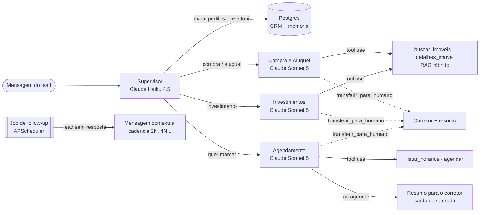

# 🏠 ImobiQ — Agente SDR Imobiliário com IA Generativa


-D97757)


POC do **Hackathon FIAP — Pós Tech IA para Devs (Fase 5)** · Turma 8IADT · Grupo 65: um agente SDR para **imóveis comerciais** que atende empresas e investidores, conversa de forma humanizada, faz a qualificação B2B (atividade, espaço, orçamento, quem decide e prazo), sugere salas, conjuntos, lajes, lojas, galpões e prédios de uma base simulada, agenda visitas com o corretor especialista, faz follow-up automático e envia resumos aos corretores. O código também suporta imóveis residenciais (campo de segmento).

> 🚧 Documentação completa (arquitetura, explicação da IA, demo e pitch) será finalizada ao longo do desenvolvimento.

---

## 🧱 Stack

| Camada | Tecnologia |
|---|---|
| 🧠 LLMs | Claude Sonnet 5 (conversa) · Claude Haiku 4.5 (roteamento, extração, resumo, follow-up) |
| 🕸️ Orquestração | LangGraph (supervisor + agentes especialistas, memória com checkpointer Postgres) |
| ⚙️ Backend | Python 3.12 · FastAPI · SQLAlchemy · Alembic |
| 🗄️ Dados | PostgreSQL 16 + pgvector |
| 🔎 RAG | Busca híbrida: embeddings locais (fastembed, MiniLM multilíngue) + full-text search em português, fundidos por RRF |
| 🖥️ Frontend | Next.js 16 · React 19 · TypeScript · Tailwind CSS 4 · lucide-react |
| 📈 Observabilidade | Langfuse |
| ☁️ Infra | Docker Compose · AWS |

## 🤖 Como o agente funciona



- **Supervisor (Haiku):** a cada mensagem, lê a conversa e devolve o perfil do lead em saída estruturada: segmento, empresa, cargo, se é o decisor, atividade, área ou nº de pessoas, requisitos, orçamento, região, urgência e perfil de investidor (no residencial, quartos). Regras determinísticas calculam campos faltantes (no comercial, seguindo o BANT: necessidade, orçamento, autoridade e prazo), score (0-100), temperatura e etapa do funil, e escolhem o agente que responde. O perfil registra só o que o cliente disse: a finalidade (compra, aluguel ou investimento) exige um trecho citado literalmente da mensagem do cliente, conferido pelo código, e a busca de imóveis fica travada até ela ser declarada. O telefone é pedido ao agendar ou encaminhar, uma única vez.
- **Agentes (Sonnet):** persona humanizada ("Laris"), uma pergunta por vez, guiada pela lista de campos faltantes. *Locação e Compra* e *Investimentos* (imóveis locados, cap rate) qualificam e sugerem imóveis; *Agendamento* consulta a agenda do corretor especialista no tipo de imóvel (escritórios, salas e consultórios, lojas, galpões, ou o especialista em investimentos) e confirma visitas e reuniões. A busca entende a linguagem do cliente ("escritório", "ponto", "depósito", "Faria Lima", "Augusta") e filtra por atividade permitida, área, vagas, docas e pé-direito.
- **Resumo inteligente:** ao agendar ou encaminhar, o corretor recebe um briefing estruturado (perfil, necessidades, imóveis de interesse, objeções, próximos passos, abordagem sugerida) **por e-mail**, com o convite de calendário (.ics) da visita anexado. No modo demonstração, todos os e-mails vão para uma única caixa, com o corretor de destino no assunto.
- **Follow-up automático:** um job reserva leads sem resposta (`FOR UPDATE SKIP LOCKED`, seguro com várias instâncias) e envia mensagens com o contexto da conversa. Cada tentativa usa uma estratégia (retomar, agregar valor, encerrar), com cadência crescente; depois da última, o lead vai para *perdido*. Se ele voltar, a conversa continua de onde parou. O envio pode ser pausado, ter a cadência ajustada ou um horário de silêncio definido em tempo real na tela de configurações.
- **Memória:** o histórico completo (inclusive ferramentas e follow-ups) é o estado do grafo LangGraph, persistido no Postgres pelo checkpointer. A conversa continua mesmo após reiniciar a API.
- **Observabilidade:** com as chaves do Langfuse no `.env`, cada turno vira um trace agrupado por conversa, com os nós do grafo, cada chamada ao Claude (tokens, cache, latência) e cada ferramenta.

### 💬 API

| Método | Rota | Descrição |
|---|---|---|
| `POST` | `/chat/sessions` | Inicia uma conversa (cria o lead) |
| `POST` | `/chat/{lead_id}/messages` | Envia mensagem; resposta via **SSE** (`analysis`, `agent`, `token`, `tool`, `properties`, `appointment`, `handoff`, `done`) |
| `GET` | `/chat/{lead_id}/messages` | Histórico da conversa (inclui follow-ups) |
| `GET` | `/leads` | Leads com score, temperatura e etapa do funil (filtros: `status`, `temperature`, `intent`) |
| `GET` | `/leads/{lead_id}` | Detalhe do lead: perfil, resumo, agendamentos e conversa |
| `POST` | `/leads/{lead_id}/summary` | Gera ou atualiza o resumo para o corretor |
| `POST` | `/leads/{lead_id}/summary/email` | Envia o resumo ao corretor por e-mail agora |
| `GET` | `/appointments` | Próximos agendamentos |
| `GET` | `/dashboard/metrics` | KPIs: funil, temperatura, intenção, agendamentos e follow-ups |
| `GET` / `PUT` | `/config/followup` | Lê/altera o follow-up em tempo real (liga/desliga, minutos, tentativas, horário de silêncio) |
| `GET` / `PUT` | `/config/email` | Lê/altera o envio de e-mails (liga/desliga, modo demonstração, caixa de demonstração) |
| `POST` | `/config/email/test` | Envia um e-mail de teste para validar o SMTP |
| `POST` | `/followups/run` | Dispara o ciclo de follow-up na hora, mesmo pausado (útil na demo) |
| `POST` | `/admin/demo/reset` | Apaga leads/conversas/agenda e recria os dados de demonstração |

## 🖥️ Telas

| Tela | O que mostra |
|---|---|
| 💬 **Chat do lead** (`/chat`) | Conversa no estilo WhatsApp com a Laris: resposta em streaming, indicador do que a IA está fazendo ("consultando imóveis…"), cards dos imóveis sugeridos, confirmação de agendamento e follow-ups que chegam sozinhos. Ao lado, o painel **"O que a IA está entendendo"** mostra em tempo real o agente ativo, score, temperatura, perfil extraído e as próximas perguntas da qualificação. |
| 📊 **Dashboard do corretor** (`/dashboard`) | Indicadores (leads, taxa de qualificação, quentes, agendamentos, follow-ups), funil por etapa, intenção dos leads, próximos agendamentos e tabela de leads com filtros. Atualiza sozinho a cada 10s. |
| 🗂️ **Detalhe do lead** (`/dashboard/leads/{id}`) | Resumo inteligente para o corretor (gerar/atualizar), status e histórico do e-mail ao corretor (com reenvio), perfil, agendamentos e a conversa completa, com o agente que respondeu cada mensagem e os follow-ups marcados. |
| 🧩 **Chat no widget** (`/embed`) | Versão enxuta do chat usada dentro do iframe do widget, com a marca da imobiliária, saudação sobre o imóvel da página e botão de fechar. |
| ⚙️ **Configurações** (`/configuration`) | Liga/desliga do follow-up com efeito imediato, minutos até a 1ª tentativa, máximo de tentativas, horário de silêncio e botão "rodar agora". Controla o e-mail aos corretores (liga/desliga, modo demonstração, e-mail de teste). Também reseta os dados de demonstração (8 leads em todas as etapas do funil, com conversas, resumos e agendamentos). |

A conversa fica salva no navegador (o lead é retomado ao recarregar); use **Nova conversa** para simular outro lead. Os atalhos iniciais do chat reproduzem os três cenários do enunciado.

## 🧩 Widget para sites de imobiliárias

A Laris pode ser instalada no site de qualquer imobiliária com uma linha, antes de `</body>`:

```html
<script src="https://SEU-APP/widget.js" data-brand="Nome da Imobiliária" data-property="IMV-007" defer></script>
```

- Uma bolha flutuante abre o chat num iframe (tela cheia no celular). O chat só carrega no primeiro clique, sem pesar no site, e o CSS fica isolado (Shadow DOM).
- A Laris se apresenta em nome da imobiliária (`data-brand`) e, na página de um imóvel (`data-property`), já abre falando dele e responde sobre "este imóvel".
- O dashboard mostra a origem do lead: site, página de entrada e campanha (UTM de primeiro toque).
- A conversa continua se o visitante recarregar ou mudar de página (a sessão fica guardada no domínio do site).
- Opcionais: `data-teaser-delay` (segundos até o convite aparecer; `0` desliga) e `data-position="left"`. API JavaScript: `ImobiQ.open()`, `ImobiQ.close()`, `ImobiQ.toggle()`.

O site fictício da **Imobiliária Exemplo** (`site-exemplo/`) é gerado a partir da mesma base de imóveis e serve de demonstração. Para produção, gere apontando para o widget publicado e suba a pasta `dist/` em qualquer hospedagem estática:

```bash
python site-exemplo/build.py --widget https://SEU-APP/widget.js
```

No WordPress, a linha do script pode ser colocada com um plugin de inserção de código no rodapé (ex.: WPCode).

## 📁 Estrutura

```
api/    FastAPI + agentes (app/), migrations (alembic/), seed (scripts/), testes (tests/)
web/    Next.js — chat do lead, dashboard do corretor, configurações e o widget (public/widget.js)
site-exemplo/  gerador do site fictício da "Imobiliária Exemplo", com o widget embutido
data/   base simulada: 100 imóveis comerciais em SP e região (gerador determinístico), corretores por especialidade e leads de demonstração
docs/   arquitetura, explicação da IA e pitch
```

## 🚀 Como rodar

Pré-requisitos: Docker Desktop. Para desenvolvimento local: Python 3.12 + [uv](https://docs.astral.sh/uv/) e Node 22.

```bash
cp .env.example .env              # preencha ANTHROPIC_API_KEY
python site-exemplo/build.py      # gera o site fictício (site-exemplo/dist)
docker compose up -d --build      # db + api + web + mailpit + site
docker compose exec api python -m scripts.seed --demo   # --demo: cria também os leads de exemplo
```

| Serviço | URL |
|---|---|
| 🖥️ Web | http://localhost:3001 |
| ⚙️ API (Swagger) | http://localhost:8001/docs |
| 📬 Mailpit (e-mails de teste) | http://localhost:8025 |
| 🏠 Site fictício com o widget | http://localhost:5500 |

> ℹ️ As portas 3000/8000 costumam estar ocupadas no Windows, por isso o padrão é 3001/8001 (configurável no `.env`).

### 🛠️ Desenvolvimento local (sem containerizar api/web)

```bash
docker compose up -d db
cd api && uv sync && uv run alembic upgrade head && uv run python -m scripts.seed
uv run uvicorn app.main:app --reload --port 8001
cd ../web && npm install && npm run dev
```

### ✅ Testes

```bash
cd api && uv run pytest     # requer o db rodando e o seed aplicado
RUN_LLM_TESTS=1 uv run pytest tests/test_agent_scenarios.py   # cenários do enunciado com o Claude (custa tokens)
uv run ruff check .
```

## 🗺️ Roadmap

- [x] **Dia 1** — Fundação: Docker Compose, schema (leads, mensagens, imóveis, corretores, agenda), base simulada, RAG híbrido, esqueleto web
- [x] **Dia 2** — Grafo multiagente (supervisor, compra/aluguel, investidor), extrator de perfil, memória, `/chat` com streaming
- [x] **Dia 3** — Agente de agendamento, resumo para corretor, follow-up automático, observabilidade (Langfuse)
- [x] **Dia 4** — Chat do lead (streaming + painel da IA em tempo real), dashboard do corretor e detalhe do lead
- [ ] **Dia 5** — Diferenciais: deploy AWS, segurança, WhatsApp, Voice AI, CRM
- [ ] **Dia 6** — Documentação, demo e pitch
