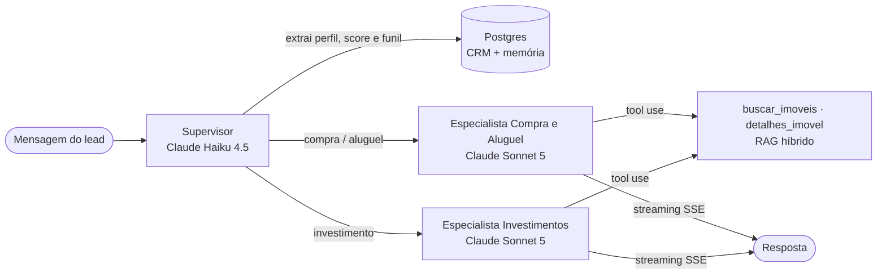

# 🏠 ImobIA — Agente SDR Imobiliário com IA Generativa


-D97757)


POC do **Hackathon FIAP — Pós Tech IA para Devs (Fase 5)**: um agente SDR que atende leads imobiliários, conversa de forma humanizada, qualifica (compra, aluguel ou investimento), sugere imóveis de uma base simulada, agenda visitas, faz follow-up automático e gera resumos para corretores.

> 🚧 Documentação completa (arquitetura, explicação da IA, demo e pitch) será finalizada ao longo do desenvolvimento.

---

## 🧱 Stack

| Camada | Tecnologia |
|---|---|
| 🧠 LLMs | Claude Sonnet 5 (conversa) · Claude Haiku 4.5 (roteamento, extração, resumo, follow-up) |
| 🕸️ Orquestração | LangGraph (supervisor + agentes especialistas, memória com checkpointer Postgres) |
| ⚙️ Backend | Python 3.12 · FastAPI · SQLAlchemy · Alembic |
| 🗄️ Dados | PostgreSQL 16 + pgvector |
| 🔎 RAG | Busca híbrida: embeddings locais (fastembed, MiniLM multilíngue) + full-text search em português, fundidos por RRF |
| 🖥️ Frontend | Next.js 16 · TypeScript · Tailwind CSS |
| 📈 Observabilidade | Langfuse |
| ☁️ Infra | Docker Compose · AWS |

## 🤖 Como o agente funciona



- **Supervisor (Haiku):** a cada mensagem, lê a conversa e devolve o perfil do lead em saída estruturada (intenção, orçamento, região, quartos, urgência, perfil investidor...). Regras determinísticas calculam campos faltantes, score (0-100), temperatura e etapa do funil, e escolhem o especialista.
- **Especialistas (Sonnet):** persona humanizada ("Lia"), uma pergunta por vez, guiada pela lista de campos faltantes; buscam imóveis via tool use e respondem em streaming.
- **Memória:** o histórico completo (inclusive chamadas de ferramentas) é o estado do grafo LangGraph, persistido no Postgres pelo checkpointer — a conversa continua mesmo após reiniciar a API.

### 💬 API de chat

| Método | Rota | Descrição |
|---|---|---|
| `POST` | `/chat/sessions` | Inicia uma conversa (cria o lead) |
| `POST` | `/chat/{lead_id}/messages` | Envia mensagem; resposta via **SSE** (`analysis`, `agent`, `token`, `tool`, `properties`, `done`) |
| `GET` | `/chat/{lead_id}/messages` | Histórico da conversa |

## 📁 Estrutura

```
api/    FastAPI + agentes (app/), migrations (alembic/), seed (scripts/), testes (tests/)
web/    Next.js — chat do lead e dashboard do corretor
data/   base simulada: 100 imóveis em SP (gerador determinístico) e corretores
docs/   arquitetura, explicação da IA e pitch
```

## 🚀 Como rodar

Pré-requisitos: Docker Desktop. Para desenvolvimento local: Python 3.12 + [uv](https://docs.astral.sh/uv/) e Node 22.

```bash
cp .env.example .env              # preencha ANTHROPIC_API_KEY
docker compose up -d --build      # db + api + web
docker compose exec api python -m scripts.seed
```

| Serviço | URL |
|---|---|
| 🖥️ Web | http://localhost:3001 |
| ⚙️ API (Swagger) | http://localhost:8001/docs |

> ℹ️ As portas 3000/8000 costumam estar ocupadas no Windows, por isso o padrão é 3001/8001 (configurável no `.env`).

### 🛠️ Desenvolvimento local (sem containerizar api/web)

```bash
docker compose up -d db
cd api && uv sync && uv run alembic upgrade head && uv run python -m scripts.seed
uv run uvicorn app.main:app --reload --port 8001
cd ../web && npm install && npm run dev
```

### ✅ Testes

```bash
cd api && uv run pytest     # requer o db rodando e o seed aplicado
RUN_LLM_TESTS=1 uv run pytest tests/test_agent_scenarios.py   # cenários do enunciado com o Claude (custa tokens)
uv run ruff check .
```

## 🗺️ Roadmap

- [x] **Dia 1** — Fundação: Docker Compose, schema (leads, mensagens, imóveis, corretores, agenda), base simulada, RAG híbrido, esqueleto web
- [x] **Dia 2** — Grafo multiagente (supervisor, compra/aluguel, investidor), extrator de perfil, memória, `/chat` com streaming
- [ ] **Dia 3** — Agendamento, resumo para corretor, follow-up automático, Langfuse
- [ ] **Dia 4** — Chat do lead e dashboard do corretor
- [ ] **Dia 5** — Diferenciais: deploy AWS, segurança, WhatsApp, Voice AI, CRM
- [ ] **Dia 6** — Documentação, demo e pitch
