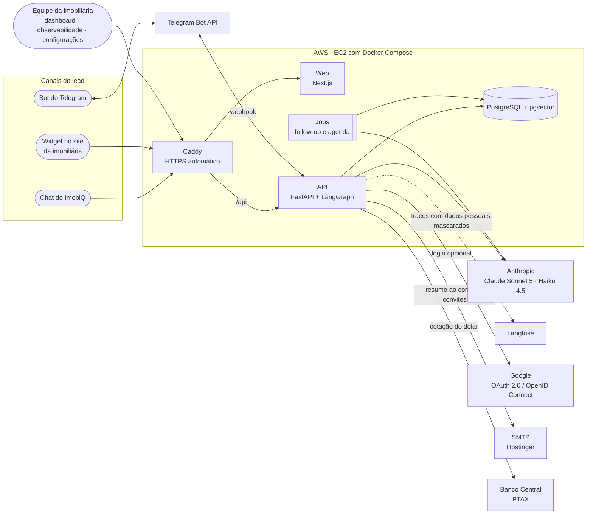
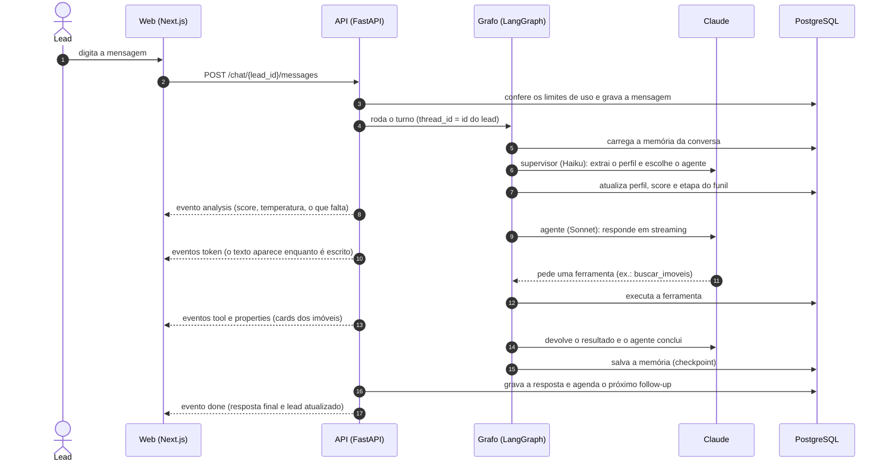
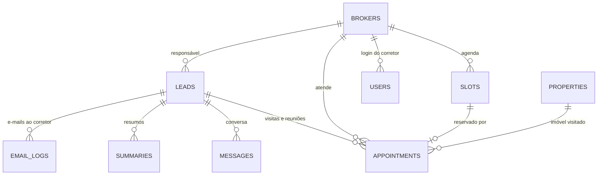
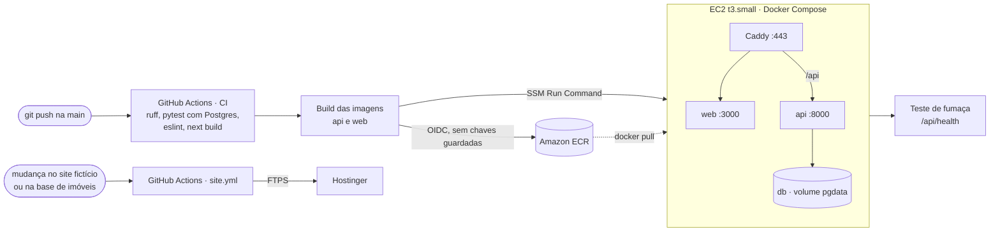

# 🏗️ Arquitetura do ImobiQ

Este documento descreve como o ImobiQ está montado: os componentes, como uma mensagem do lead percorre o sistema, onde ficam os dados, como o acesso é controlado e como a solução é publicada. A parte de inteligência artificial (modelos, agentes, prompts, busca e custos) está em **[ia.md](ia.md)**; o passo a passo de publicação está em **[deploy.md](deploy.md)**.

## 🎯 Visão geral

O ImobiQ é um agente SDR (pré-atendimento comercial) para imobiliárias de imóveis comerciais. A assistente, chamada **Laris**, atende o lead, faz a qualificação, sugere imóveis de uma base simulada, agenda a visita com o corretor certo, retoma o contato de quem parou de responder e entrega ao corretor um resumo da conversa.

Três decisões organizam o desenho:

1. **Um só núcleo para todos os canais.** O chat do ImobiQ, o widget no site da imobiliária e o bot do Telegram chamam a mesma função (`run_turn`), que roda o mesmo grafo de agentes sobre a mesma memória. Um canal novo é só um adaptador de entrada e saída.
2. **Todo o estado num único PostgreSQL.** CRM, conversas, memória dos agentes, base de imóveis com embeddings, agenda, configurações, usuários e o registro de uso da IA. A API não guarda nada que precise sobreviver a um reinício.
3. **A IA decide a conversa; o código decide as regras.** Score, etapa do funil, campos que faltam, escolha do corretor, trava do telefone e limites de uso são regras em Python, testadas sem chamar o modelo.

## 🧩 Componentes



| Componente | Tecnologia | Responsabilidade |
|---|---|---|
| **Web** | Next.js 16, React 19, TypeScript, Tailwind CSS 4 | Chat do lead, dashboard do corretor, detalhe do lead, observabilidade, configurações, login e as páginas legais. Serve também o `widget.js` e a rota `/embed`, que é o chat dentro do iframe do widget. |
| **API** | Python 3.12, FastAPI, SQLAlchemy 2, Alembic | Rotas REST e o streaming da conversa (SSE), autenticação e papéis, o grafo de agentes, as ferramentas, o envio de e-mail e a integração com o Telegram. |
| **Jobs** | APScheduler, dentro do processo da API | Follow-up automático (verificado a cada 30 s) e reposição dos horários da agenda (a cada 6 h). |
| **Banco** | PostgreSQL 16 com a extensão pgvector | Todo o estado da aplicação (ver [Dados](#-dados)). |
| **Proxy** | Caddy 2 | Certificado HTTPS automático, o app na raiz do domínio e a API em `/api`. Mesma origem para o navegador, então não há CORS entre o app e a API. |
| **Site fictício** | HTML estático gerado por `site-exemplo/build.py` | Site de uma imobiliária de exemplo, hospedado na Hostinger em outro domínio, com o widget embutido. Prova a integração em um site de terceiros. |

Serviços externos e o módulo que isola cada um:

| Serviço | Para quê | Módulo |
|---|---|---|
| Anthropic (Claude) | Conversa, extração do perfil, resumo e follow-up | `api/app/agents/llm.py` |
| Telegram Bot API | Canal de mensageria | `api/app/services/telegram.py` |
| Langfuse | Traces detalhados de cada turno | `api/app/core/observability.py` |
| Google (OAuth 2.0 / OpenID Connect) | Login alternativo da equipe | `api/app/services/google_oauth.py` |
| SMTP (Hostinger) | Resumo ao corretor, convites e redefinição de senha | `api/app/services/mailer.py` |
| Banco Central (PTAX) | Cotação do dólar do painel de custos | `api/app/services/exchange.py` |

As alternativas para cada um desses serviços (WhatsApp, modelos da OpenAI e do Google, Azure, Google Cloud e outros) e o que muda em cada troca estão na tabela "Componentes externos e alternativas" do [README](../README.md#-componentes-externos-e-alternativas).

### Organização do código

```
api/app/
  agents/     grafo, prompts, qualificação, ferramentas, guardrails e o cliente do Claude
  api/routes/ rotas HTTP: chat, leads, auth, users, admin, observability, telegram, widget
  core/       configuração, autenticação, senhas, observabilidade, preços e máscara de dados pessoais
  services/   regras de negócio: turno de conversa, busca de imóveis, agenda, resumo, e-mail, Telegram,
              limites de uso, configurações em tempo real e os números do painel
  jobs/       follow-up e agendador
  models/     tabelas (SQLAlchemy)     schemas/  contratos da API (Pydantic)
web/src/
  app/        páginas (chat, dashboard, observabilidade, configurações, embed, legais)
  components/ chat, dashboard, observabilidade, configurações, sessão e login
  lib/        cliente da API e formatação
```

## 💬 O caminho de uma mensagem

O que acontece quando o lead envia uma mensagem pelo chat web. No widget e no Telegram o miolo é o mesmo; muda só quem recebe e quem entrega.



Pontos que valem destacar:

- **Streaming por SSE.** A resposta sai como uma sequência de eventos (`analysis`, `agent`, `token`, `tool`, `properties`, `slots`, `appointment`, `handoff`, `done`). É por isso que o chat mostra o texto sendo escrito, o aviso "consultando imóveis…" e o painel "O que a IA está entendendo" em tempo real.
- **Uma mensagem por vez por conversa.** Cada turno roda numa thread própria com uma trava por lead, para duas mensagens seguidas não se misturarem na memória.
- **Falha do modelo não derruba a conversa.** Se o supervisor falha, o perfil anterior é mantido e a conversa segue. Se o agente falha, a Laris pede para o cliente repetir. O registro de uso e o envio de traces nunca interrompem o atendimento.
- **IA pausada ou teto diário atingido.** O turno não chama o modelo: a Laris responde um recado fixo, pede nome e telefone e guarda a mensagem para o corretor.

### Os três canais

| Canal | Entrada | Particularidades |
|---|---|---|
| **Chat do ImobiQ** (`/chat`) | `POST /chat/{id}/messages` com resposta em SSE | O id da conversa fica no navegador; ao recarregar, o chat retoma por `GET /chat/{id}/state`, rota do próprio visitante, que não traz o que é interno do CRM. |
| **Widget** (`widget.js` + `/embed`) | A mesma rota do chat, a partir de um iframe | Uma linha de script no site da imobiliária cria a bolha (CSS isolado em Shadow DOM) e só carrega o chat no primeiro clique. O script repassa a página, o imóvel em foco e as UTMs, e a Laris abre falando do imóvel que o visitante está vendo. A sessão fica guardada no domínio do site, não no iframe. |
| **Telegram** | Webhook `POST /webhooks/telegram` em produção, long polling no ambiente local | Cada chat vira um lead com canal Telegram. Os horários de visita chegam como botões e os follow-ups chegam no próprio Telegram. Um link de uso único (30 minutos) leva a conversa do site para o bot sem perder o contexto. |

## 🗄️ Dados



| Tabela | Conteúdo |
|---|---|
| `leads` | O lead e tudo o que a qualificação descobriu: segmento, empresa, cargo, decisor, atividade, área ou número de pessoas, requisitos, finalidade, orçamento, regiões, urgência e perfil de investidor. Guarda também score, temperatura, etapa do funil, corretor responsável, canal, origem (site, página, campanha) e o controle do follow-up. |
| `messages` | Histórico exibido no chat e no dashboard: quem falou, qual agente respondeu, imóveis citados, follow-ups e a marca de suspeita de prompt injection. |
| `summaries` | Resumos gerados para o corretor, em formato estruturado e em texto. |
| `properties` | Base simulada: 76 imóveis (68 comerciais e 8 residenciais), com atributos estruturados, atributos comerciais em JSON (atividades permitidas, docas, pé-direito, inquilino) e o embedding de 384 dimensões. |
| `brokers`, `slots`, `appointments` | Corretores por especialidade, horários de uma hora em dias úteis e os agendamentos. |
| `email_logs` | Cada e-mail enviado ao corretor, com situação e erro, se houver. |
| `usage_events` | Uma linha por chamada ao Claude, por ferramenta, por fluxo e por suspeita de injection, com tokens, custo e latência. É a fonte do painel de observabilidade. |
| `users` | Equipe com acesso: e-mail, papel, hash da senha, vínculo com o corretor e aceite dos termos. |
| `app_settings` | Configurações que a tela de administração altera em tempo real: IA ligada ou pausada, follow-up, e-mail, limites, domínios do widget, Telegram e câmbio. |
| tabelas `checkpoint*` | Memória dos agentes, criada e mantida pelo checkpointer do LangGraph. |

Duas escolhas de modelagem:

- **Conversa guardada em dois lugares, com papéis diferentes.** `messages` é o histórico para as pessoas (chat e dashboard). O checkpoint do LangGraph é a memória do agente, no formato da API do Claude, incluindo as chamadas de ferramenta e os resultados.
- **`usage_events` não tem chave estrangeira para `leads`.** O reset dos dados de demonstração apaga os leads; o histórico de custo precisa continuar.

## 🔐 Acesso e segurança

O chat, o widget e o Telegram são públicos. O dashboard, os leads, a observabilidade e as configurações exigem login, e só entra quem foi convidado por um administrador.

| Papel | O que acessa |
|---|---|
| **Administrador** | Tudo, incluindo usuários e configurações. |
| **Gestor** | Todos os leads e a observabilidade. |
| **Corretor** | Só os leads atribuídos a ele e as visitas dele, com os indicadores no mesmo recorte. |
| **Visualizador** | Só leitura (pensado para a banca avaliadora). |

- **Sessão:** token assinado (HMAC) num cookie `HttpOnly` de 12 horas. O papel é conferido no servidor a cada requisição, e desativar um usuário corta o acesso na hora.
- **Senhas:** só o hash scrypt com sal é guardado. O convidado cria a própria senha por um link de uso único (72 horas) e aceita os termos nesse momento; "esqueci minha senha" envia um link de 1 hora. As tentativas de login são limitadas por hora e a resposta não revela se um e-mail existe.
- **Google:** fluxo de código de autorização feito no servidor, com validação do emissor, do destinatário, da validade e do e-mail verificado. Só entra quem já foi convidado (ou está na lista de administradores do `.env`).
- **Limites de uso:** por conversa, por IP, conversas novas por IP e um teto diário de mensagens que funciona como trava de custo.
- **Widget:** com a restrição ligada, o `widget.js` não mostra a bolha fora dos domínios permitidos, o navegador bloqueia o iframe pela regra `frame-ancestors` e a API recusa conversas vindas de outras páginas.
- **Dados pessoais:** telefone, e-mail, CPF e CNPJ são mascarados antes de qualquer trace sair para o Langfuse. O banco da aplicação guarda os dados completos, porque o corretor precisa deles.
- **Segredos:** só no `.env`, fora do Git. O token do Telegram nunca aparece em logs nem em mensagens de erro.

As defesas específicas da IA (prompt injection, escopo das ferramentas, respostas sem invenção) estão em [ia.md](ia.md#-segurança-da-ia).

## 📈 Observabilidade

Há dois registros, com finalidades diferentes:

- **No próprio banco (`usage_events`).** Sempre ligado. Cada chamada ao Claude é gravada com agente, modelo, tokens por tipo, latência e custo calculado pela tabela de preços. O painel `/observability` lê daqui: custo total, custo por conversa e por visita agendada, economia com cache, tempo de resposta, custo por agente e por modelo, ferramentas usadas e tentativas de injection. Os valores em reais usam a cotação do dia (PTAX), com uma cotação fixa de reserva.
- **No Langfuse.** Opcional, ligado pelas chaves no `.env`. Guarda o detalhe de cada turno (entrada e saída de cada nó, cada chamada e cada ferramenta), agrupado por conversa. O dashboard tem link direto para a sessão de cada lead.

O painel não depende do Langfuse nem da cota da API dele.

## ☁️ Implantação



- **Uma máquina, quatro contêineres:** `caddy`, `web`, `api` e `db`. É o caminho mais simples para uma POC e usa os mesmos artefatos do ambiente local.
- **Sem chaves da AWS no GitHub:** o pipeline assume uma role por OIDC e recebe credenciais temporárias. **Sem porta 22 aberta:** a atualização é feita pelo SSM Run Command.
- **Cada deploy** baixa as imagens novas, aplica as migrations (Alembic, na subida da API) e roda o seed, que só insere o que falta.
- **Instância parada não quebra o pipeline:** as imagens vão para o ECR e a atualização da EC2 é pulada com um aviso.
- **Ambiente local:** `docker compose up` sobe os mesmos serviços, mais o Mailpit (captura os e-mails, nada sai de verdade) e um servidor estático para o site fictício.

Custos, o passo a passo do console e a operação do dia a dia estão em [deploy.md](deploy.md).

## 📐 Escalabilidade e limites da POC

O que já está preparado para crescer:

- **API sem estado.** A memória dos agentes, as sessões e as configurações ficam no Postgres, então é possível rodar várias cópias da API atrás de um balanceador.
- **Follow-up seguro com várias instâncias.** O job reserva os leads com `FOR UPDATE SKIP LOCKED`; duas cópias não enviam a mesma mensagem.
- **Agenda sem reserva dupla.** O horário é travado na transação do agendamento.
- **Serviços externos isolados em módulos.** Trocar o provedor de modelo, o canal ou a nuvem não toca nos agentes.

O que é limite conhecido e qual seria o próximo passo:

| Limite na POC | Próximo passo |
|---|---|
| Banco no mesmo servidor, em volume Docker, com backup manual (`pg_dump`) | PostgreSQL gerenciado (Amazon RDS) com backup automático e réplica. |
| Contadores de limite por IP e travas por conversa em memória do processo | Redis, para valerem entre várias cópias da API. |
| Jobs dentro do processo da API | Agendador e fila próprios (EventBridge Scheduler + SQS), com um worker separado. |
| Resumo ao corretor gerado numa fila em memória (2 threads) | A mesma fila externa, com nova tentativa garantida após reinício. |
| Busca vetorial sem índice aproximado (76 imóveis, varredura completa) | Índice HNSW do pgvector quando a base passar de alguns milhares de imóveis. |
| Uma imobiliária por instalação | Separação por cliente (multi-imobiliária), com base de imóveis e equipe próprias. |
| Base de imóveis simulada, carregada por seed | Importação do feed de imóveis dos portais ou do CRM da imobiliária. |

## ✅ Qualidade

- **Cerca de 120 testes automatizados** rodam a cada push, com um Postgres real (pgvector) e sem chamar o modelo: qualificação e score, busca de imóveis, agenda, follow-up, e-mail, Telegram, autenticação e papéis, limites de uso e o painel de custos.
- **Cenários com o Claude de verdade** (`RUN_LLM_TESTS=1`) reproduzem os exemplos do enunciado e as regressões encontradas em conversas reais. Ficam fora do pipeline porque custam tokens; estão descritos em [ia.md](ia.md#-avaliação).
- **Os testes nunca tocam os dados do app:** usam um banco próprio (`sdr_test`), não enviam e-mail e gravam os traces num ambiente separado.
- **Pipeline:** `ruff check`, `ruff format --check`, `pytest`, `eslint` sem avisos e `next build` (que confere os tipos).
