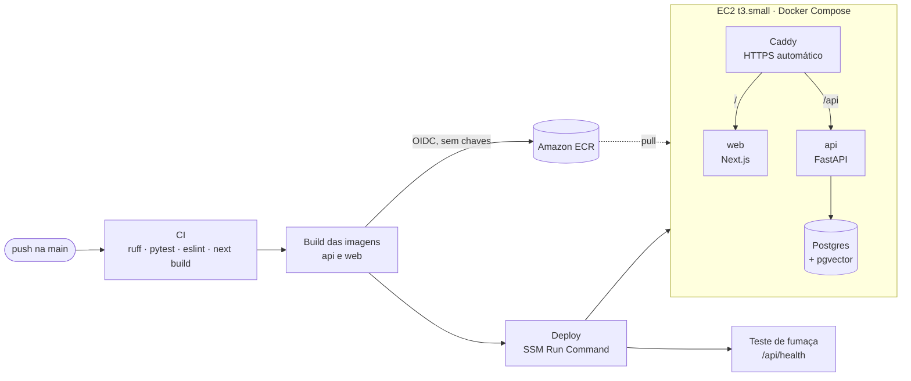

# 🚀 Deploy na AWS (EC2 + GitHub Actions)

Cada push na `main` testa, empacota e publica o ImobiQ sozinho em **https://imobiq.arrtsoftware.com.br**.



## 🔒 Decisões de segurança

- **Nenhuma chave da AWS no GitHub:** o Actions assume a role `imobiq-github-deploy` por **OIDC**, com credenciais temporárias que valem só para aquela execução. A role só aceita a branch `main` deste repositório e só pode enviar imagens para os dois repositórios do ECR e rodar comandos na instância com a tag `App=imobiq`.
- **Nenhuma porta de administração aberta:** o deploy usa o **SSM Run Command** e o acesso ao servidor, o **Session Manager** (pelo console). A instância recebe só tráfego HTTP/HTTPS (80/443).
- **Segredos só no servidor:** o `.env` de produção fica em `/opt/imobiq/.env` (permissão 600), criado à mão. Não passa pelo GitHub nem pelas imagens.
- **HTTPS com renovação automática** (Caddy + Let's Encrypt), HSTS e cabeçalhos de segurança.
- **Migrations automáticas:** a API roda `alembic upgrade head` ao subir; o seed (imóveis, embeddings, corretores, agenda) é idempotente e roda a cada deploy.

## 💰 Custo (us-east-1)

| Item | Custo mensal aproximado |
|---|---|
| EC2 t3.small (2 GB) 24h + 2 GB de swap | US$ 15,20 |
| Disco gp3 de 20 GB | US$ 1,60 |
| Elastic IP (IPv4 público) | US$ 3,65 |
| ECR (imagens) e GitHub Actions (2.000 min/mês grátis em repositório privado) | centavos |
| **Total** | **≈ US$ 20/mês** |

Parada (Stop), a instância não cobra; só o disco e o IP continuam.

---

## Passo a passo (uma vez)

Tudo em **us-east-1 (N. Virginia)**: confira a região no canto superior direito do console.

### 0. Alerta de orçamento
**Billing and Cost Management → Budgets → Create budget** → *Use a template* → **Monthly cost budget** → valor **25 USD** → seu e-mail → *Create budget*. A AWS avisa por e-mail se o gasto previsto passar do valor.

### 1. Repositórios de imagens (ECR)
**Elastic Container Registry → Private repositories → Create repository**, duas vezes:
- `imobiq-api`
- `imobiq-web`

Use exatamente esses nomes, **sem prefixo/namespace** (ex.: `hacka/imobiq-api` não funciona): o pipeline e a policy da role usam esses nomes, e repositórios do ECR não podem ser renomeados. Padrões: *Mutable*, criptografia AES-256. Vale ligar *Scan on push* e uma *lifecycle policy* que mantém as 10 imagens mais recentes.

### 2. Provedor OIDC do GitHub
**IAM → Identity providers → Add provider**
- Provider type: **OpenID Connect**
- Provider URL: `https://token.actions.githubusercontent.com`
- Audience: `sts.amazonaws.com`
- *Add provider*

### 3. Role do GitHub Actions
**IAM → Roles → Create role**
1. Trusted entity type: **Custom trust policy** → cole o conteúdo de [`deploy/aws/github-oidc-trust-policy.json`](../deploy/aws/github-oidc-trust-policy.json) → *Next*.
   O `sub` usa o formato **immutable subject** do GitHub, com os IDs numéricos do dono e do repositório (`repo:rodrigoaraujorosa@7645207/fiap-ia-devs-8iadt-fase5-hackaton@1384460240:ref:refs/heads/main`): mesmo que alguém recrie um repositório com o mesmo nome, a role não aceita. Para conferir o prefixo de outro repositório: `gh api repos/<dono>/<repo>/actions/oidc/customization/sub` (campo `sub_claim_prefix`). Com o `sub` errado, o deploy falha com *Not authorized to perform sts:AssumeRoleWithWebIdentity*.
2. Não marque nenhuma política → *Next* → Role name: **`imobiq-github-deploy`** → *Create role*.
3. Abra a role → **Add permissions → Create inline policy** → aba **JSON** → cole [`deploy/aws/github-deploy-policy.json`](../deploy/aws/github-deploy-policy.json) → *Next* → nome **`imobiq-deploy`** → *Create policy*.
4. Copie o **ARN** da role (ex.: `arn:aws:iam::528704558835:role/imobiq-github-deploy`).

### 4. Role da instância EC2
**IAM → Roles → Create role**
1. Trusted entity type: **AWS service** → Use case: **EC2** → *Next*.
2. Marque **`AmazonSSMManagedInstanceCore`** e **`AmazonEC2ContainerRegistryReadOnly`** → *Next*.
3. Role name: **`imobiq-ec2`** → *Create role*.

### 5. Instância EC2
**EC2 → Instances → Launch instances**
- **Name and tags:** nome `imobiq` → *Add additional tags* → Key **`App`**, Value **`imobiq`** (o deploy só roda em instâncias com essa tag).
- **AMI:** Amazon Linux 2023 (64-bit x86).
- **Instance type:** `t3.small`.
- **Key pair:** *Proceed without a key pair* (o acesso é pelo Session Manager).
- **Network settings → Edit:** *Create security group* `imobiq-web`; **desmarque** "Allow SSH"; marque **Allow HTTPS** e **Allow HTTP** from the internet.
- **Storage:** 20 GiB, gp3.
- **Advanced details:**
  - IAM instance profile: **`imobiq-ec2`**
  - Metadata version: **V2 only (token required)**
  - **User data:** cole o conteúdo de [`deploy/ec2-user-data.sh`](../deploy/ec2-user-data.sh) (instala Docker e Compose, cria o swap e a pasta `/opt/imobiq`).
- *Launch instance* → anote o **Instance ID** (`i-...`).

### 6. IP fixo (Elastic IP)
**EC2 → Elastic IPs → Allocate Elastic IP address → Allocate** → selecione o IP → **Actions → Associate Elastic IP address** → instância `imobiq` → *Associate*. Anote o IP.

### 7. DNS na Hostinger
**hPanel → Domínios → arrtsoftware.com.br → DNS / Nameservers → Gerenciar registros DNS** → adicionar:
- Tipo **A**, Nome **`imobiq`**, Aponta para **o Elastic IP**, TTL **300**.

Confira depois de alguns minutos: `nslookup imobiq.arrtsoftware.com.br` deve responder com o IP.

### 8. `.env` de produção (no servidor)
**EC2 → Instances → imobiq → Connect → Session Manager → Connect** (espere uns 3 minutos após criar a instância). No terminal:

```bash
sudo -i
docker compose version && swapon --show   # confere o user data
cd /opt/imobiq
dnf install -y nano && nano .env          # cole o modelo e preencha
chmod 600 .env
```

Use o modelo [`deploy/production.env.example`](../deploy/production.env.example). Para gerar senhas: `openssl rand -base64 24` (Postgres) e `openssl rand -hex 32` (segredo do webhook do Telegram).

### 9. Variáveis no GitHub
**Repositório → Settings → Secrets and variables → Actions → aba Variables → New repository variable** (são valores públicos, não segredos):

| Nome | Valor |
|---|---|
| `AWS_ROLE_ARN` | ARN do passo 3 |
| `AWS_REGION` | `us-east-1` |
| `EC2_INSTANCE_ID` | Instance ID do passo 5 |
| `APP_DOMAIN` | `imobiq.arrtsoftware.com.br` |

### 10. Primeiro deploy
**Actions → Deploy → Run workflow** (ou um push na `main`). O primeiro leva uns 10 minutos: build das imagens, download do modelo de embeddings e emissão do certificado. Ao final, o teste de fumaça mostra "No ar".

Depois: abra https://imobiq.arrtsoftware.com.br/configuration, entre com o `ADMIN_PASSWORD` e rode **"Resetar dados de demo"**.

### 11. Telegram
Com `TELEGRAM_MODE=webhook` no `.env` de produção, a API registra o webhook sozinha ao subir. **No `.env` local, apague o `TELEGRAM_BOT_TOKEN`** (ou use outro bot): a API local em polling apagaria o webhook de produção.

### 12. Site fictício (Hostinger)
```bash
python site-exemplo/build.py --widget https://imobiq.arrtsoftware.com.br/widget.js --zip
```
1. **hPanel → Sites → arrtsoftware.com.br → Domínios → Subdomínios:** crie `imobiliaria-exemplo` com a pasta `public_html/imobiliaria-exemplo`; confira o SSL em **Segurança → SSL**.
2. **Gerenciador de Arquivos:** envie `site-exemplo/imobiliaria-exemplo.zip` para essa pasta, **Extrair** e apague o zip. Deve aparecer a pasta `assets/` e o `index.html` na raiz.

Use o zip do `--zip`: um zip feito pelo "Compactar" do PowerShell 5.1 grava `assets\style.css`, e o servidor extrai como arquivos soltos com barra no nome (o site aparece sem estilo).

---

## 🛠️ Operação

Pelo Session Manager (`sudo -i`):

```bash
/opt/imobiq/dc ps                 # containers
/opt/imobiq/dc logs -f api        # logs da API
/opt/imobiq/dc restart api        # reinicia a API (ex.: depois de mudar o .env)
/opt/imobiq/dc exec db pg_dump -U sdr sdr > backup.sql   # backup do banco
```

- **Rollback:** Actions → Deploy → execução anterior → *Re-run all jobs* (republica aquele commit).
- **Economizar:** EC2 → Instance state → *Stop* quando não estiver usando; *Start* para voltar (o Elastic IP, os dados e o certificado continuam).
