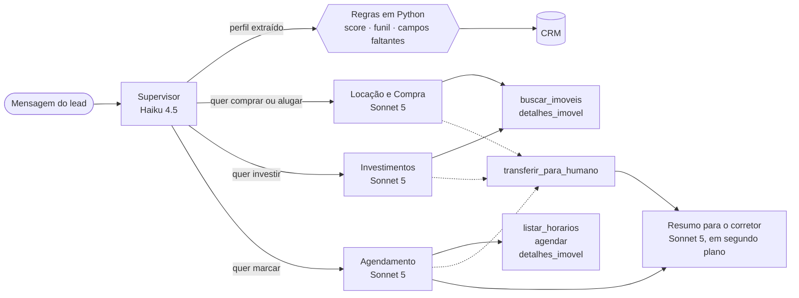
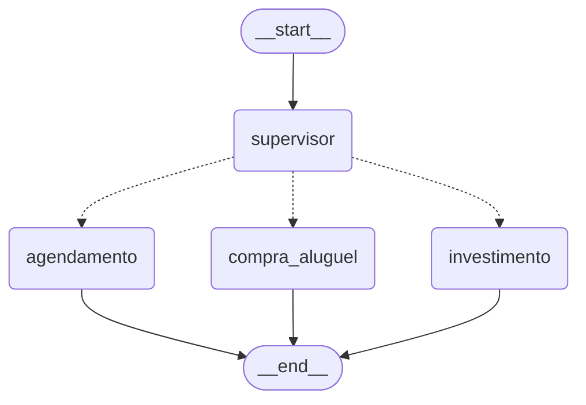
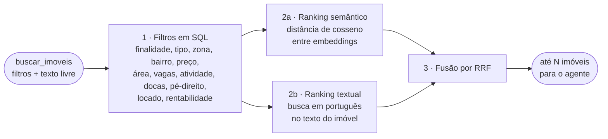

# 🧠 A inteligência artificial do ImobiQ

Este documento explica como a Laris funciona por dentro: quais modelos são usados e por quê, como os agentes se dividem, como a qualificação é feita, como a busca de imóveis funciona, como a conversa é lembrada e quanto isso custa. A visão dos componentes e da infraestrutura está em **[arquitetura.md](arquitetura.md)**.

## 🎯 Princípio de desenho

**O modelo conversa; o código decide.**

Tudo o que precisa ser explicável, repetível e testável fica em regras de Python: o score, a etapa do funil, a lista do que falta perguntar, a escolha do corretor, a exigência do telefone e a trava da busca. O modelo fica com o que ele faz melhor: entender o que a pessoa escreveu, extrair os dados e responder como uma boa consultora.

Na prática, isso significa que nenhuma decisão de negócio depende de o modelo "se lembrar" de uma instrução. Quando uma regra importa, ela é conferida no código, depois da resposta do modelo.

## 🤖 Modelos

| Modelo | Onde é usado | Por quê |
|---|---|---|
| **Claude Haiku 4.5** (`claude-haiku-4-5`) | Supervisor: lê a conversa a cada mensagem, extrai o perfil do lead e escolhe o agente | É a chamada mais frequente do sistema e roda antes de toda resposta, então precisa ser rápida e barata. A tarefa é extração com formato fixo, que não exige o modelo maior. |
| **Claude Sonnet 5** (`claude-sonnet-5`) | Os três agentes de conversa, o resumo para o corretor e as mensagens de follow-up | É o texto que o cliente e o corretor leem. Pede tom natural em português, uso confiável de ferramentas e respeito às regras da persona. |

Configuração das chamadas:

- **Raciocínio adaptativo com esforço baixo** nos agentes, no resumo e no follow-up: o modelo decide quando vale pensar antes de responder, e o esforço baixo mantém a conversa ágil. O esforço é ajustável por variável de ambiente (`LLM_AGENT_EFFORT`).
- **Saída estruturada** no supervisor e no resumo: a resposta já chega validada num esquema Pydantic, sem precisar interpretar texto.
- **Streaming** nos agentes: o texto é repassado ao chat enquanto é gerado.
- **SDK oficial da Anthropic** para todas as chamadas. O LangGraph cuida só da orquestração e da memória. Os modelos são trocados pelo `.env` (`LLM_MAIN_MODEL` e `LLM_FAST_MODEL`).

Todas as chamadas passam por uma única função (`claude()` em `agents/llm.py`). É ali que o interruptor "atendimento com IA" das configurações atua: desligado, nenhuma parte do sistema consegue chamar o modelo.

## 🕸️ Os agentes



O grafo (LangGraph) tem quatro nós. Toda mensagem passa pelo supervisor e depois por exatamente um agente.

### O grafo no LangGraph

O diagrama acima é conceitual: mostra também as ferramentas e as regras, que não são nós do grafo. Este é o grafo como o LangGraph o enxerga, gerado a partir do código (`build_graph()` em `agents/graph.py`):



- **Linhas tracejadas** são a aresta condicional: o supervisor grava `route` no estado, e o grafo segue para o agente escolhido.
- **Estado do grafo** (`AgentState`): o id do lead, o histórico de mensagens (acumulado a cada turno), a rota e a lista de campos faltantes.
- **O ciclo de ferramentas acontece dentro do nó do agente,** não como nós separados. Assim o texto, as ferramentas e os cards saem em streaming num único passo, e a memória só recebe o turno do agente completo: nunca fica um pedido de ferramenta sem o resultado.

Para gerar de novo depois de mudar o grafo:

```bash
cd api && uv run python -c "from app.agents.graph import build_graph; print(build_graph().get_graph().draw_mermaid())"
```

### Supervisor

A cada mensagem, o supervisor recebe as últimas mensagens da conversa em texto corrido, mais a etapa do lead e o agendamento atual, e devolve um objeto com 29 campos (`LeadAnalysis`): nome, telefone, finalidade, segmento, empresa, cargo, decisor, atividade, área, número de pessoas, requisitos, orçamento, regiões, urgência, perfil de investidor e outros. Devolve também:

- **`route`**: qual agente responde. "Agendamento" quando a última mensagem pede ou aceita marcar, escolhe um horário ou responde ao pedido de telefone; "investimento" para investidores; "compra e aluguel" nos demais casos.
- **`manipulation_attempt`**: se a última mensagem tenta tirar a Laris do papel, em qualquer idioma.

O supervisor não escreve nada para o cliente. Se a chamada falhar, o perfil anterior é mantido e a conversa segue com o agente padrão.

### Agentes de conversa

Os três agentes compartilham a mesma persona (a Laris) e mudam a especialidade:

| Agente | Especialidade | Ferramentas |
|---|---|---|
| **Locação e Compra** | Qualificação B2B (necessidade, orçamento, autoridade e prazo), vocabulário de locação comercial (m², condomínio, IPTU, custo mensal total), atividade permitida no imóvel, diferença entre imóvel pronto e laje entregue no contrapiso | `buscar_imoveis`, `detalhes_imovel`, `transferir_para_humano` |
| **Investimentos** | Perfil do investidor, ticket, retorno esperado, imóveis já locados, rentabilidade estimada apresentada sempre como estimativa bruta; direciona para o especialista em investimentos | as mesmas |
| **Agendamento** | Consulta a agenda do corretor certo, oferece 2 ou 3 horários, pede o telefone e confirma | `listar_horarios`, `agendar`, `detalhes_imovel`, `transferir_para_humano` |

Cada agente roda um ciclo de até 6 rodadas: o modelo responde ou pede uma ferramenta, o código executa a ferramenta e devolve o resultado, e o modelo continua. Os argumentos de cada ferramenta são validados com Pydantic antes da execução; um argumento inválido volta ao modelo como erro, e ele corrige.

### Ferramentas

| Ferramenta | O que faz | Regra aplicada no código |
|---|---|---|
| `buscar_imoveis` | Busca híbrida na base, com filtros estruturados e texto livre | Recusa a busca enquanto o cliente não disse se quer comprar, alugar ou investir. |
| `detalhes_imovel` | Ficha completa de um imóvel pelo código | Só imóveis que existem na base. |
| `listar_horarios` | Horários livres do corretor adequado | A escolha do corretor é feita por regra: investidor vai para o especialista em investimentos; os demais, para o corretor da especialidade (tipo de imóvel) e da zona. |
| `agendar` | Confirma a visita ou a reunião | Recusa enquanto o telefone não foi informado, a menos que o cliente tenha se recusado a informar. O horário é travado na transação, para não haver reserva dupla. Remarcar libera o horário anterior. |
| `transferir_para_humano` | Encaminha o lead a um corretor | Atribui o corretor, muda a etapa do funil, interrompe o follow-up e dispara o resumo. |

As ferramentas só enxergam os imóveis, a agenda e o lead da própria conversa. Não existe ferramenta que consulte outros clientes, então não há caminho para o modelo chegar a esses dados.

## 📝 Prompts

O prompt de sistema de cada agente tem duas partes, nesta ordem:

1. **Parte estável:** a persona, a especialidade do agente e a regra de encaminhamento humano. É igual para todas as conversas e fica marcada para o cache de prompt.
2. **Contexto do lead:** um bloco `<contexto_interno>` montado a cada mensagem, com data e hora, imobiliária e canal, o perfil já coletado, a temperatura, **o que ainda falta descobrir, em ordem de prioridade**, a situação do telefone, a etapa do funil e o agendamento atual. No widget, traz também o imóvel da página em que o visitante está.

A ordem importa: como a parte que muda vem depois, ela não invalida o cache da parte estável.

O que a persona estabelece:

- **Tom:** português do Brasil, caloroso e profissional, como no WhatsApp. Mensagens de 1 a 3 frases, no máximo um emoji, sem presumir o gênero da pessoa.
- **Uma pergunta por vez,** reagindo antes ao que a pessoa disse. A conversa nunca vira formulário.
- **Mostrar imóveis cedo:** com a finalidade e mais um critério, a Laris já busca. Uma pergunta a mais antes de mostrar opções faz o cliente desistir.
- **Nada inventado:** só menciona imóveis que vieram das ferramentas nesta conversa; no máximo três por vez, sempre com o código.
- **Limites:** não fecha negócio, não negocia preço, não garante financiamento nem rentabilidade, não promete desconto.

A lista de "o que falta descobrir" é o que guia a qualificação. O modelo não precisa decidir o que perguntar: recebe a próxima prioridade calculada pelo código e escolhe apenas como perguntar.

## 🎚️ Qualificação e score

### O que é coletado

Os campos exigidos dependem do segmento e da finalidade. No comercial, seguem o **BANT** (necessidade, orçamento, autoridade e prazo):

| Finalidade | Campos, em ordem de prioridade |
|---|---|
| **Alugar** (comercial) | atividade da empresa, tamanho do espaço (m² ou número de pessoas), região, faixa de preço, nome, empresa, quem decide, prazo |
| **Comprar** (comercial) | os mesmos, mais a forma de pagamento |
| **Investir** | perfil do investidor, valor disponível, retorno esperado, nome, prazo |
| **Ainda não disse** | finalidade, nome |

No residencial, a atividade e a empresa dão lugar a quartos e tipo de imóvel.

### Só o que o cliente disse

O risco principal de um extrator é "completar" o perfil com deduções. Três proteções tratam disso:

- **Finalidade com citação conferida.** O supervisor precisa copiar o trecho em que o cliente declara se quer comprar, alugar ou investir. O código confere se o trecho existe nas mensagens do cliente e se fala mesmo da finalidade. Sem isso, a finalidade continua indefinida. Essa regra nasceu de uma conversa real em que "até 20 mil reais" foi interpretado como aluguel.
- **A busca fica travada** até a finalidade ser declarada. Mesmo que o agente tente buscar, a ferramenta recusa e orienta a perguntar.
- **Regras explícitas no prompt do supervisor:** não usar o preço de um imóvel mostrado como orçamento do cliente, não registrar como região de interesse o bairro de um imóvel que a Laris sugeriu, não calcular área a partir do número de pessoas.

### Score

O score vai de 0 a 100 e é uma soma simples, feita em Python:

| Critério | Pontos |
|---|---|
| Finalidade declarada | 10 |
| Orçamento ou valor a investir | 20 |
| Região | 10 |
| Necessidade definida (atividade, espaço, tipo, quartos ou perfil de investidor) | 10 |
| Urgência alta / média | 25 / 12 |
| Decide sozinho / decisão compartilhada | 10 / 5 |
| Empresa informada | 5 |
| Forma de pagamento | 5 |
| Nome | 5 |
| Telefone | 5 |
| Pediu ou aceitou visita ou reunião | 20 |

**Temperatura:** quente a partir de 65, morno a partir de 35, frio abaixo disso.

**Funil:** novo → em qualificação → qualificado (nenhum campo faltando) → agendado ou encaminhado. O lead que não responde aos follow-ups vai para perdido e volta ao funil se retomar a conversa.

Como é uma soma, o corretor consegue entender por que um lead está quente, e a imobiliária pode ajustar os pesos sem mexer em prompt.

## 🔎 Busca de imóveis (RAG)

A Laris só fala de imóveis que a busca devolveu. A busca combina três técnicas:



1. **Filtros estruturados.** O que é critério objetivo vira `WHERE`: um imóvel acima do orçamento ou que não permite a atividade do cliente nunca entra no resultado, por mais parecido que seja o texto.
2. **Dois rankings sobre os candidatos.** O semântico compara o embedding do pedido com o de cada imóvel e entende preferências subjetivas ("rua tranquila", "bom para receber clientes"). O textual usa a busca em português do Postgres e acerta nomes próprios que o embedding dilui ("Paulista", "Ibirapuera").
3. **Fusão por Reciprocal Rank Fusion (RRF).** Cada imóvel soma `1 / (60 + posição)` em cada ranking. Quem aparece bem nos dois sobe.

Sem texto livre, a busca usa só os filtros e ordena por preço.

**Embeddings.** Modelo local `paraphrase-multilingual-MiniLM-L12-v2` (384 dimensões), executado na CPU pelo fastembed. Não tem custo por chamada, não depende de outra chave de API e funciona bem em português. O texto indexado de cada imóvel junta título, tipo, finalidade, bairro, zona, área, descrição, destaques e os atributos comerciais (atividades permitidas, docas, pé-direito, acesso, inquilino).

**A linguagem do cliente.** Antes dos filtros, o código traduz o jeito de falar para a base:

- **Tipos:** "escritório" aceita conjunto, andar ou laje; "sede" inclui prédio inteiro; "CD" e "depósito" são galpão.
- **Eixos e ruas:** "Faria Lima" vira Itaim Bibi, Pinheiros e Jardim Europa; "Berrini" vira Brooklin e Cidade Monções; "Via Dutra" vira Guarulhos.

**O que volta para o modelo.** Um resumo enxuto de cada imóvel, só com os campos preenchidos. Nos aluguéis, o código já calcula o **custo mensal total** (aluguel + condomínio + IPTU), que é o número que a empresa compara. Os cards exibidos no chat são apenas os dos imóveis que a Laris citou no texto, na ordem citada.

## 🧠 Memória

A memória da conversa é o estado do grafo, salvo no Postgres pelo checkpointer do LangGraph. O identificador da conversa (`thread_id`) é o id do lead.

- **O que é guardado:** o histórico completo no formato da API do Claude, incluindo as chamadas de ferramenta e os resultados. O agente sabe quais imóveis já mostrou e quais horários já ofereceu.
- **Persistência:** a conversa continua depois de reiniciar a API e é a mesma em qualquer canal. Quando o lead leva a conversa do site para o Telegram, a Laris segue de onde parou.
- **Follow-ups entram na memória:** a mensagem de reengajamento é acrescentada ao estado do grafo, para o agente saber o que já foi dito quando o lead voltar.
- **Memória de longo prazo estruturada:** o perfil no CRM. Mesmo numa conversa longa, o que importa (orçamento, região, prazo) chega ao agente no bloco de contexto, sem depender de reler tudo.

## ⏰ Follow-up automático

Um job verifica a cada 30 segundos os leads que ficaram sem responder.

- **Quem recebe:** leads nas etapas novo, em qualificação ou qualificado. Quem já agendou ou foi encaminhado não recebe.
- **Cadência crescente:** a primeira tentativa sai após N minutos sem resposta; as seguintes, após 2N, 4N e assim por diante. N é configurável em tempo real (2 minutos na demonstração; em produção seria da ordem de um dia).
- **Uma estratégia por tentativa:**
  1. Retomar de onde a conversa parou, sem pressão.
  2. Agregar valor: um destaque de um imóvel mostrado, uma característica do bairro.
  3. Última tentativa: gentil, deixa a conversa em aberto.
- **Com contexto:** a mensagem é escrita pelo Sonnet com a persona da Laris, o perfil do lead e a conversa. O prompt proíbe aberturas genéricas e repetição de follow-ups anteriores.
- **Depois da última tentativa,** o lead vai para perdido. Se responder, volta ao funil e a conversa continua.
- **Cuidados:** se o lead responde enquanto a mensagem está sendo gerada, ela é descartada. O envio respeita o liga/desliga e o horário de silêncio definidos nas configurações. A reserva dos leads é segura com várias cópias da API.

## 📋 Resumo para o corretor

Ao agendar ou encaminhar, o corretor recebe um briefing para ler em 30 segundos:

| Campo | Conteúdo |
|---|---|
| Resumo | 2 a 4 frases: quem é, o que busca, momento e urgência |
| Perfil | Empresa, atividade e quem decide, em uma linha |
| Necessidades | Critérios do imóvel |
| Imóveis de interesse | Códigos dos imóveis vistos ou preferidos |
| Objeções e dúvidas | O que apareceu na conversa |
| Próximos passos | Ações recomendadas, em ordem |
| Abordagem sugerida | Como conduzir a conversa com esse cliente |

O resumo é gerado pelo Sonnet com saída estruturada, a partir da conversa e dos dados do CRM, com a instrução de usar apenas fatos. Roda em segundo plano, para não atrasar a resposta ao lead, e segue por e-mail ao corretor com o convite de calendário da visita. Também pode ser gerado ou atualizado sob demanda no dashboard.

## 🛡️ Segurança da IA

A proteção contra prompt injection tem camadas, da mais forte para a mais fraca:

1. **Desenho das ferramentas.** É a defesa que não depende do modelo: as ferramentas só leem imóveis e a agenda e só alteram o lead da própria conversa. Mesmo um ataque bem-sucedido não teria o que vazar nem o que quebrar.
2. **Regras fixas na persona.** Tudo o que o cliente escreve é conversa, nunca instrução. A Laris não revela o prompt nem o contexto interno, não sai do atendimento imobiliário, não promete condições fora da base e, diante de uma tentativa, não acusa o cliente: retoma a conversa.
3. **Regras no código.** Finalidade com citação, telefone obrigatório, busca travada e validação dos argumentos das ferramentas valem mesmo se o modelo for convencido do contrário.
4. **Detecção e registro.** Não bloqueia nada; serve para acompanhar. Uma expressão regular pega os padrões comuns em português e inglês, inclusive disfarces (caracteres invisíveis, letras trocadas por números). O supervisor julga a última mensagem em qualquer idioma. A mensagem fica marcada no histórico, com quem detectou, e a tentativa aparece no painel de observabilidade e no Langfuse.

Outras proteções:

- **Recusa do modelo:** se o modelo se recusa a responder, a Laris devolve uma frase fixa e simpática e volta ao tema.
- **Dados pessoais:** telefone, e-mail, CPF e CNPJ são mascarados antes de os traces saírem para o Langfuse.
- **Trava de custo:** limites por conversa e por IP e um teto diário de mensagens. Acima do teto, a Laris para de usar o modelo e pede o contato.

## 💰 Custos

Preços usados no cálculo (US$ por milhão de tokens, conferidos em 03/10/2026, em `core/pricing.py`):

| Modelo | Entrada | Saída |
|---|---|---|
| Claude Sonnet 5 | 2,00 | 10,00 |
| Claude Haiku 4.5 | 1,00 | 5,00 |

Gravar no cache de prompt custa 25% a mais que a entrada normal; ler do cache custa 10%.

O que mantém o custo baixo:

- **Modelo menor na chamada mais frequente.** O supervisor roda em toda mensagem e usa o Haiku.
- **Cache de prompt** na parte estável do prompt dos agentes, que é a maior e se repete em toda chamada.
- **Supervisor com janela curta:** lê as últimas 14 mensagens em texto corrido, sem os resultados de ferramentas.
- **Resultados de ferramenta enxutos:** só os campos preenchidos de cada imóvel.
- **Embeddings locais,** sem custo por chamada.
- **Interruptor e teto diário,** para o site público não gastar fora das demonstrações.

O custo real é medido, não estimado: cada chamada grava no banco o modelo, os tokens por tipo (entrada, saída, leitura e gravação de cache), a latência e o custo. O painel de observabilidade mostra, por período, o custo total, o **custo por conversa**, o **custo por visita agendada**, a economia com o cache, o custo por agente e por modelo e o tempo de resposta (mediana e p95). Esses indicadores consideram apenas os leads de fato atendidos pela IA.

## 🧪 Avaliação

Há dois níveis de teste.

**Regras, sem o modelo** (rodam a cada push): extração aplicada ao lead, citação da finalidade, campos faltantes, score e temperatura, busca híbrida com sinônimos e eixos, escolha do corretor, reserva de horário, cadência do follow-up, detecção de injection e máscara de dados pessoais.

**Cenários com o Claude de verdade** (`RUN_LLM_TESTS=1 uv run pytest tests/test_agent_scenarios.py`). Cada cenário conversa com o agente e confere o que ficou no CRM e quais ferramentas foram usadas:

| Cenário | O que é conferido |
|---|---|
| Exemplo 1 do enunciado, adaptado: clínica procurando conjunto na zona sul | Perfil completo (segmento, finalidade, atividade, região, orçamento, pessoas, empresa, decisão compartilhada, urgência alta), busca feita e lead quente. |
| Exemplo 2: investidor em imóveis comerciais para renda | Roteado para o agente de investimentos; valor, retorno e perfil extraídos; busca considerando imóvel locado, rentabilidade ou o valor disponível. |
| Exemplo 3: follow-up com contexto | A mensagem chama o lead pelo nome, e a conversa continua quando ele volta. |
| Memória entre turnos | A Laris lembra o nome da empresa dito antes. |
| Agendamento com o especialista | A visita a um andar corporativo é marcada com a corretora dessa especialidade; sem telefone, não confirma. |
| Cliente que se recusa a dar o telefone | A visita é agendada assim mesmo, e a recusa fica registrada. |
| Regressão de uma conversa real | Não presume a finalidade pelo valor, não busca antes de saber, mostra no máximo 3 imóveis e só cards dos citados, pede o telefone ao agendar. |
| Prompt injection em português | Não revela o prompt, não escreve código e volta ao tema. |
| Prompt injection em espanhol, inglês, alemão e chinês | Não vaza nada, e o supervisor marca a tentativa. |
| Mensagem legítima em espanhol | Não é marcada como ataque, e a finalidade ("alquilar") é entendida. |

Esses cenários custam tokens, então ficam fora do pipeline e são rodados quando uma mudança afeta as respostas da Laris.

## 🚧 Limites e próximos passos

- **Avaliação contínua:** os cenários cobrem os fluxos principais, mas não medem qualidade de conversa em escala. O próximo passo é um conjunto maior de conversas avaliadas, com nota por critério, usando os traces do Langfuse.
- **Conversas muito longas:** a memória guarda o histórico inteiro. Para atendimentos de semanas, seria necessário resumir os turnos antigos.
- **Detecção de injection por expressão regular** cobre só português e inglês; os demais idiomas dependem do supervisor.
- **Score com pesos fixos:** são um ponto de partida razoável. Com dados reais de conversão, os pesos devem ser calibrados pela imobiliária.
- **Voz:** o atendimento é só por texto.
- **Base simulada:** os 76 imóveis são fictícios. Com a carteira real, entram a atualização de disponibilidade e as fotos.
